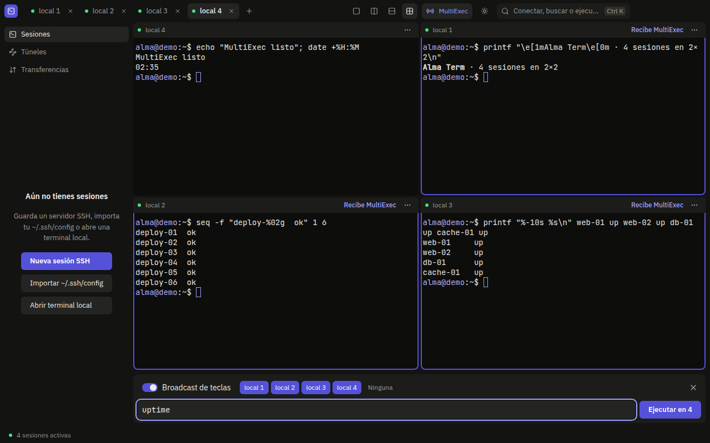
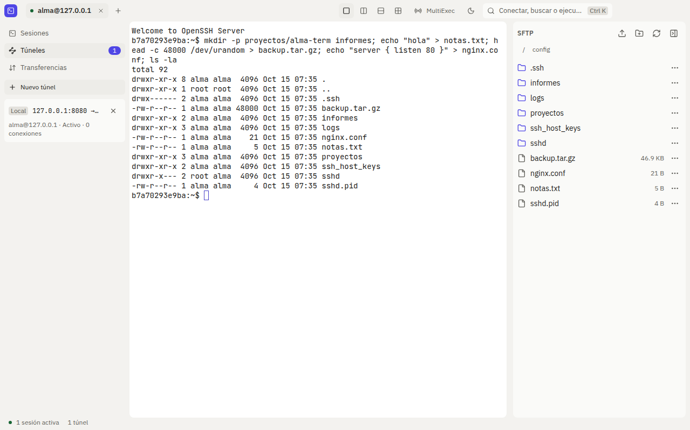
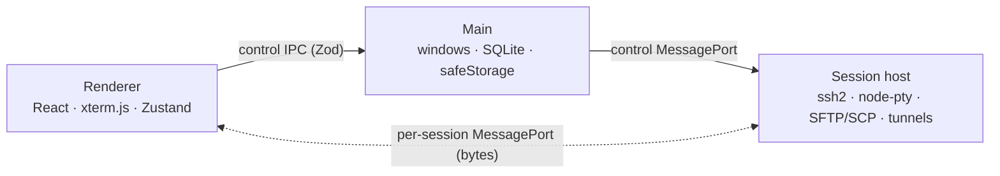

<div align="center">

# Alma Term

**A modern desktop SSH client built with Electron, React and strict TypeScript.**

Local and SSH terminals, a side SFTP panel on the same connection (with SCP fallback), split panes, MultiExec, `-L`, `-R` and `-D` tunnels, and a session manager with encrypted credentials. Dark and light themes.

[](https://github.com/johnmadrigal5-droid/alma-term/actions/workflows/ci.yml)
[](https://github.com/johnmadrigal5-droid/alma-term/releases/latest)


**[Download the latest release](https://github.com/johnmadrigal5-droid/alma-term/releases/latest)**



</div>

## Features

|                          |                                                                                                                                                                                                                                                                                                                                                                       |
| ------------------------ | --------------------------------------------------------------------------------------------------------------------------------------------------------------------------------------------------------------------------------------------------------------------------------------------------------------------------------------------------------------------- |
| **Terminals**            | Local (`node-pty`) and SSH (`ssh2`) terminals on xterm.js with WebGL, credit-based flow control and a replay buffer.                                                                                                                                                                                                                                                  |
| **Secure SSH**           | Host key verification with SHA-256 fingerprints, hashed `known_hosts`, password, private key, agent and keyboard-interactive (2FA) authentication.                                                                                                                                                                                                                    |
| **Side SFTP panel**      | Browse, upload, download, rename, change permissions and delete over the same connection, with no second login. Transfer queue with 2 parallel transfers, pause, cancel and retry. If the server has no SFTP, it falls back to **SCP mode** (over `exec`) with a limited-features notice.                                                                             |
| **Split panes**          | 1 pane, 2 columns, 2 rows or 2×2. Tabs drag between panes and each one remembers its own. Separators work with mouse and keyboard.                                                                                                                                                                                                                                    |
| **MultiExec**            | Send a command to several sessions or broadcast every keystroke. Arrow keys are translated to each terminal's mode and each target's bracketed paste is respected.                                                                                                                                                                                                    |
| **SSH tunnels**          | Local (`-L`), remote (`-R`) and dynamic (`-D`, built-in SOCKS5 proxy) forwarding over each session's connection. They listen on `127.0.0.1` only unless you opt in explicitly. They can be saved with the session and opened on connect.                                                                                                                              |
| **Session manager**      | Folders, search, `~/.ssh/config` import and credentials encrypted with `safeStorage` (DPAPI, Keychain or libsecret).                                                                                                                                                                                                                                                  |
| **Keyboard first**       | `Ctrl K` palette and shortcuts for almost everything (table below). Visible focus, full keyboard navigation and WCAG AA contrast verified in both themes.                                                                                                                                                                                                             |
| **Session logs**         | Every session is written to a plain-text file with a timestamp on each line (no colors or escape codes), one file per session named `host_date_time.log`. Files are readable by your user only. Open or change the folder from the command palette (`Ctrl K`); the default is `Documents/Alma Term/logs`. What you type is not logged, only what the terminal prints. |
| **Light and dark theme** | Switch from the title bar or the palette; the choice is remembered across launches, with no flash.                                                                                                                                                                                                                                                                    |

The interface is currently in Spanish.



## Installation

Download the installer for your system from [Releases](https://github.com/johnmadrigal5-droid/alma-term/releases). The binaries are **not code-signed**, so each system warns you the first time:

| System      | File                                          | First launch                                                                                                                                                                    |
| ----------- | --------------------------------------------- | ------------------------------------------------------------------------------------------------------------------------------------------------------------------------------- |
| **Windows** | `Alma-Term-Setup-<version>.exe`               | SmartScreen warns: click **More info**, then **Run anyway**.                                                                                                                    |
| **macOS**   | `Alma-Term-<version>-arm64.dmg` or `-x64.dmg` | The app is ad-hoc signed. Drag it to _Applications_ and open it with right click, **Open**. If macOS blocks it: `xattr -dr com.apple.quarantine "/Applications/Alma Term.app"`. |
| **Linux**   | `Alma-Term-<version>.AppImage` or `.deb`      | AppImage: `chmod +x Alma-Term-*.AppImage` and run it (needs `libfuse2`, or set `APPIMAGE_EXTRACT_AND_RUN=1`). Debian and Ubuntu: `sudo apt install ./Alma-Term-*.deb`.          |

## Shortcuts

On macOS, `Ctrl` is `⌘`.

| Shortcut                  | Action                                                                                    |
| ------------------------- | ----------------------------------------------------------------------------------------- |
| `Ctrl K`                  | Command palette (inside a terminal use `Ctrl ⇧ K`, because `Ctrl K` belongs to the shell) |
| `Ctrl ⇧ T`                | New local terminal                                                                        |
| `Ctrl ⇧ W`                | Close the active tab (`Del` closes the focused tab)                                       |
| `Ctrl Tab` / `Ctrl ⇧ Tab` | Next / previous tab                                                                       |
| `Ctrl 1…9`                | Go to tab 1…9                                                                             |
| `Ctrl ⇧ D`                | Cycle the pane layout (1 → 2 columns → 2 rows → 2×2)                                      |
| `Ctrl ⇧ F`                | Show or hide the SFTP panel                                                               |
| `Ctrl ⇧ M`                | Open MultiExec and focus its field                                                        |

## Architecture

Terminal bytes never go through the main process. An isolated session process (`utilityProcess`) talks to the renderer over one `MessagePort` per session, and every message is validated with Zod at each boundary.



| Process          | Responsibility                                                                                                                                                                |
| ---------------- | ----------------------------------------------------------------------------------------------------------------------------------------------------------------------------- |
| **Main**         | Windows, dialogs, SQLite database (`node:sqlite` + Drizzle), `safeStorage` encryption, host supervision and restart, a warning when closing with active transfers or tunnels. |
| **Preload**      | Minimal, typed `window.api`; forwards the `MessagePort`s to the main world.                                                                                                   |
| **Session host** | One `ssh2` connection per server with shell, SFTP or SCP, tunnels and the transfer queue; local PTY. It does not import `electron`.                                           |
| **Renderer**     | UI, stores, xterm.js and MultiExec. No Node and no secrets.                                                                                                                   |

The protocol lives in [`packages/protocol`](packages/protocol): Zod discriminated unions shared by the three processes.

## Security

- `contextIsolation`, `sandbox` and no `nodeIntegration`; strict CSP sent from main; navigation and new windows blocked.
- **Electron fuses** in the packaged binary: `RunAsNode` and `NODE_OPTIONS` disabled, the app only loads from its `asar`, and cookies are encrypted.
- Every IPC channel validates the frame origin and the message with Zod.
- Passwords and passphrases are encrypted with `safeStorage`; only main decrypts them, at connect time. They never reach the renderer or the logs.
- Host keys are verified by SHA-256 fingerprint. A changed key does not connect until you decide.
- Tunnels listen on `127.0.0.1`; any other address requires an explicit opt-in, validated in the protocol and not only in the UI.
- SCP mode shell-escapes every path and validates file names; a hostile name cannot run anything on the server or escape the folder.

## Project layout

```
apps/desktop/
  src/main/       startup, control IPC, database, encryption, host supervisor
  src/preload/    window.api
  src/host/       session host: ssh2, SFTP and SCP, tunnels, transfer queue, pty
  src/renderer/   React + Tailwind
  e2e/            Playwright against the real app and an OpenSSH server in Docker
packages/protocol/  Zod schemas and types for every message
docs/images/        README screenshots
```

## Development

Requirements: Node 24 and pnpm 10. Docker is optional (integration and SSH E2E tests).

```bash
pnpm install          # on Linux this also rebuilds node-pty for Electron
pnpm dev              # app with hot reload
pnpm test             # unit tests (Vitest)
pnpm test:native      # host integration against OpenSSH in Docker
pnpm e2e              # Playwright E2E (needs a display; on Linux without a desktop, Xvfb)
pnpm lint && pnpm typecheck
```

Installers (in `apps/desktop/release/`):

```bash
pnpm --filter @alma/desktop dist:linux   # AppImage and deb
pnpm --filter @alma/desktop dist:win     # NSIS installer (from Linux it uses Docker with wine)
pnpm --filter @alma/desktop dist:mac     # dmg (macOS only)
```

CI (`.github/workflows`) runs Prettier, ESLint, type checks, unit and native tests, and the E2E suite with a real keychain. The `release.yml` workflow packages on Linux, Windows and macOS, starts each binary with `ALMA_SMOKE_TEST=1` and, when a `v*` tag is pushed, leaves a draft release.

## Quality

- Strict TypeScript with no `any`, and Zod on every cross-process message and IPC channel.
- TDD in the host and the protocol: more than 800 unit tests, integration tests against `linuxserver/openssh-server` (SFTP, SCP, tunnels, transfers) and E2E tests of the success criteria on the packaged app.
- Accessibility checked with axe-core in both themes (zero serious or critical violations), focus trapped and restored in dialogs, targets of at least 24 px.
- WCAG AA contrast verified by a test that recomputes each theme's token matrix.

## Contributing

Report bugs and ideas in [Issues](https://github.com/johnmadrigal5-droid/alma-term/issues). For a code change, open a pull request against `main` with `pnpm lint`, `pnpm typecheck` and `pnpm test` passing; commits follow `type(scope): description`.

## License

[MIT](LICENSE) © 2026 John Madrigal
